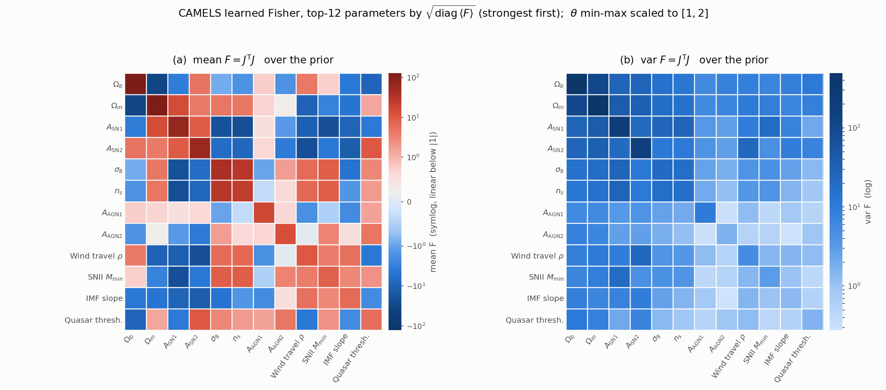
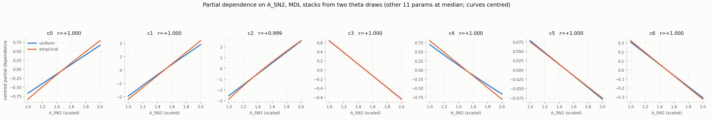

# CAMELS one-step results

Date: 2026-10-02. Branch: `new_idea`. Seed: 0 for every run.

Data: CAMELS SB35. 1024 simulations. 35 parameters. 344 scaling-relation
features. The split gives 819 training simulations and 205 held-out
simulations.

---

## 1. Summary

The one-step map finds 7 informative directions. Three independent tests
agree. The ensemble calibrates correctly. The learned Fisher gives a better
parameter screen than the input probe.

Symbolic regression does not find nonlinear structure. The map is close to
linear in theta. Ordinary least squares beats symbolic regression on every
component.

---

## 2. Rank

The map has 7 informative axes. Three tests agree on this number.

| test | result |
|---|---|
| held-out information gap (probe, m=12) | 31x after axis 7 |
| J J^T eigengap, per ensemble member | 7, in all 10 members |
| J^T J eigenvalue gap over the prior | 31x after axis 7 |

The information spectrum is stable. A 200-step probe and a 20000-step probe
give the same values.

```
info nats  1.285 1.318 1.185 0.982 0.802 0.554 0.470 | 0.015 0.017 -0.032
lambda     19.37 15.21 12.88 9.71  6.71  5.53  2.47  | 1.54  1.39  1.25
```

Two traps apply here.

The default information floor of 0.5 cuts between 0.554 and 0.470. These two
values are adjacent. Use a floor of 0.25. The floor then sits inside the gap.

`refit_rank` adds one axis when the lambda spectrum drops by less than 10x at
the cut. The CAMELS lambda spectrum decays smoothly. The rule therefore fires
at every floor. Set `--refit-pad 0` and choose m directly.

A relative threshold on the Fisher reads rank 35 of 35. Read the gap. Do not
use a floor.

---

## 3. Ensemble and calibration

Each ensemble member now uses a different data network. The member draws its
own width, depth and activation. Before this change every member shared one
architecture and one warm-started trunk.

```
gelu:256x256x128   mish:188x188x188x188   leaky_relu:152x152
gelu:257x257x257x257   relu:232x232x232x232   swish:66x66x66x66
gelu:268x268x268x268   gelu:181x181   gelu:206x206x206   swish:229x229
```

Calibration uses a leave-one-out z score. The score follows t(K-2) under
normality. The reference width is sqrt((K-2)/(K-4)) = 1.1547 at K=10.

```
LOO ratio  0.973 0.982 1.013 0.960 1.004 1.031 1.127
```

Six of seven axes sit within 4 percent of the reference. The ensemble spread
is therefore honest.

Note one trap. The plain score `(y - mean(y)) / std(y)` has reference width
sqrt((K-1)/K). The identity `sum z^2 = K-1` forces this. Its ratio is 1.000 by
construction. It cannot detect a calibration error. Use the leave-one-out
score.

---

## 4. The learned Fisher

`F = J^T J` with `J = d eta / d theta`. The code built this matrix for the
Procrustes alignment and then discarded it. It also gives a rank test and a
parameter screen.



Panel (a) shows the mean over the prior. The matrix is signed, so the plot
uses a diverging scale. Panel (b) shows the variance over the prior. The
variance is non-negative, so the plot uses a single-hue scale. Both panels use
a log scale because both span orders of magnitude.

### 4.1 Parameter ranking

The score is `sqrt(diag(F))`. Theta is scaled to [1,2], so the scores compare
directly.

| rank | parameter | sqrt(F_ii) | probe rank |
|---|---|---|---|
| 1 | Omega_b | 11.350 | 3 |
| 2 | Omega_m | 10.920 | 1 |
| 3 | A_SN1 | 8.064 | 10 |
| 4 | A_SN2 | 7.733 | 5 |
| 5 | sigma_8 | 6.252 | 8 |
| 6 | n_s | 4.784 | 11 |
| 7 | A_AGN1 | 4.163 | **31** |
| 8 | A_AGN2 | 3.624 | **26** |
| 9 | WindFreeTravelDensFac | 3.209 | 9 |
| 10 | SNII_MinMass | 2.844 | 19 |
| 11 | IMFslope | 2.478 | 2 |
| 12 | QuasarThreshold | 2.355 | 15 |

The group-L1 input probe ranks A_AGN1 at 31 and A_AGN2 at 26. The Fisher ranks
them at 7 and 8. The probe sums influence over all axes. A parameter that
drives only a weak axis therefore scores low. That axis still needs the
parameter.

The correlation form is `C_ij = F_ij / sqrt(F_ii F_jj)`. A_AGN1 has the lowest
mean coupling in the set at 0.064. A_AGN2 is fourth lowest at 0.118. The AGN
amplitudes point almost orthogonal to the other parameters. They form their
own axis.

The strongest learned degeneracies are:

| pair | C_ij |
|---|---|
| sigma_8 x n_s | +0.964 |
| A_SN1 x SNII_MinMass | -0.947 |
| A_SN2 x WindFreeTravelDensFac | -0.901 |

### 4.2 Fisher stability

The relative scatter `sqrt(var)/|mean|` on the diagonal runs from 0.098 to
0.228. The value is uniform across all 12 parameters. The variance therefore
tracks the squared mean. A single prior-averaged Fisher summarises the map
here. Do not assume this in general.

---

## 5. Symbolic regression results

Every arm uses the same map, the same ensemble and the same alignment. Only
the SR inputs change. All arms use 20000 fresh augmentation draws with zero
overlap with the training rows.

| theta draw | basis | min R2 | mean R2 | nll_gap |
|---|---|---|---|---|
| uniform | 35 | 0.900 | 0.948 | 5.846 |
| uniform | top-12 | 0.839 | 0.917 | 5.954 |
| empirical | 35 | **0.930** | **0.962** | **5.203** |
| empirical | top-12 | 0.862 | 0.920 | 5.082 |

The empirical draw wins on both measures. The effect repeats in both bases.
Use `prior_draw="empirical"` with all 35 parameters.

A restricted basis costs 0.03 to 0.04 of the mean R2. It saves 27 percent of
the runtime.

---

## 6. The k-ladder

Each run gives SR the top-k parameters by Fisher score. k=2 gives Omega_b and
Omega_m.

| k | c0 | c1 | c2 | c3 | c4 | c5 | c6 | mean | parameter added |
|---|---|---|---|---|---|---|---|---|---|
| 2 | 0.225 | 0.640 | 0.622 | 0.784 | 0.334 | 0.337 | 0.004 | 0.421 | (Omega_b, Omega_m) |
| 3 | 0.551 | 0.640 | 0.639 | 0.820 | 0.410 | 0.433 | 0.059 | 0.507 | A_SN1 |
| 4 | 0.570 | 0.813 | 0.904 | 0.837 | 0.334 | 0.433 | 0.059 | 0.564 | A_SN2 |
| 5 | 0.734 | 0.883 | 0.904 | 0.898 | 0.682 | 0.489 | 0.100 | 0.670 | sigma_8 |
| 6 | 0.859 | 0.911 | 0.913 | 0.924 | 0.739 | 0.489 | 0.100 | 0.705 | n_s |
| 7 | 0.862 | 0.913 | 0.913 | 0.925 | 0.766 | 0.541 | **0.807** | 0.818 | A_AGN1 |
| 8 | 0.860 | 0.913 | 0.919 | 0.927 | 0.835 | **0.814** | 0.879 | 0.878 | A_AGN2 |
| 9 | 0.881 | 0.935 | 0.939 | 0.928 | 0.835 | 0.814 | 0.880 | 0.887 | WindFreeTravelDensFac |
| 10 | 0.928 | 0.940 | 0.943 | 0.928 | 0.835 | 0.861 | 0.879 | 0.902 | SNII_MinMass |
| 11 | 0.931 | 0.955 | 0.963 | 0.942 | 0.858 | 0.860 | 0.879 | 0.913 | IMFslope |
| 12 | 0.931 | 0.968 | 0.966 | 0.946 | 0.862 | 0.887 | 0.882 | 0.920 | QuasarThreshold |

Two parameters unlock a component on their own.

A_AGN1 enters at k=7. Component 6 rises from 0.100 to 0.807.

A_AGN2 enters at k=8. Component 5 rises from 0.541 to 0.814.

Component 3 needs almost nothing. Two parameters give 0.784. Twelve parameters
give 0.946. The component is a combination of the two densities.

The mean R2 climbs from 0.421 to 0.878 between k=2 and k=8. It climbs from
0.878 to 0.920 between k=8 and k=12. **Use k=8.** That set holds the two
densities, sigma_8, n_s and the four feedback amplitudes.

---

## 7. Per-component bases

Each component gets its own 4 parameters. The selector reads that component's
own Jacobian row.

| selector | mean R2 | min R2 |
|---|---|---|
| mean abs Jacobian | **0.802** | 0.624 |
| variance of Jacobian | 0.680 | 0.436 |
| global Fisher top-4 | 0.564 | 0.059 |
| all 12 parameters | 0.920 | 0.862 |

Per-component selection beats global selection. Four parameters chosen per
component give 0.802. Four parameters chosen once give 0.564.

The sensitivity selector beats the nonlinearity selector. The variance
selector picks Omega_m and Omega_b for all seven components. Those two
parameters have the largest derivative variance. The selector therefore misses
the parameter that drives each component.

Component 6 gives the clearest result:

```
mean|dJ| basis   [A_SN1, A_AGN1, A_SN2, A_AGN2]   R2 0.857
all 12 parameters                                  R2 0.882
```

The four feedback amplitudes explain component 6 to R2 0.857. No cosmological
parameter enters.

---

## 8. The map is close to linear

This is the main negative result.

| model | mean R2 | terms |
|---|---|---|
| linear regression | **0.993** | 36 |
| quadratic regression | 0.999 | 665 |
| symbolic regression, all 35 | 0.962 | 25 to 30 tokens |
| symbolic regression, top-12 | 0.920 | 25 to 30 tokens |

Ordinary least squares beats symbolic regression on every component.

Four earlier results follow from this one fact.

1. Nonlinear operators do not survive a basis change. They appear and
   disappear with no pattern across the k-ladder.
2. The partial dependence curves are straight.
3. The MDL pick sits at 75 to 87 percent of the length cap. SR spends its
   length on linear terms. The cap stops it at 12 to 13 of the 35 terms it
   needs.
4. `nll_gap` stays near 5. The symbolic stack is a truncated linear map.

### 8.1 The architecture biases this result

`Flattener` adds a linear skip to an MLP branch. The code sets the MLP branch
kernel to exact zeros. The skip kernel is `jnp.eye(35, 7)`.

```python
delta = nn.Dense(m, kernel_init=zeros, bias_init=zeros)(h)
skip  = nn.Dense(m, use_bias=False, kernel_init=lambda k,s,dt: jnp.eye(s[0],s[1],dt))(z)
return skip + delta
```

`jnp.eye(35, 7)` selects the first 7 scaled parameters. At step 0 the map is:

```
eta_init = [z_Omega_m, z_sigma_8, z_A_SN1, z_A_AGN1, z_A_SN2, z_A_AGN2, z_Omega_b]
```

The map starts as an exact linear function. The MLP branch contributes
nothing. No commit message, note or paper section records a reason for the
zeros.

The usual reason for zero init is a well-conditioned Jacobian for the
`-0.5 logdet(J J^T)` term. The measurement does not support this reason. The
skip alone gives the conditioning.

| init | logdet(J J^T) | cond(J) |
|---|---|---|
| zeros | +9.704 | 1.000 |
| glorot | +9.901 | 1.179 |

Four runs now test this. They vary the init over {zeros, glorot} and the
features over {PCA-80, raw 344}. Jobs 3839174 to 3839177.

### 8.2 Results so far

| arm | r_hat | SR mean | OLS | quadratic | nll_neural | nll_gap |
|---|---|---|---|---|---|---|
| zeros, PCA-80 | 7 | 0.961 | 0.9933 | 0.9991 | -0.699 | 5.38 |
| glorot, PCA-80 | 7 | 0.942 | 0.9796 | 0.9985 | +1.106 | 3.77 |
| zeros, raw 344 | 7 | 0.940 | 0.9934 | 0.9986 | -4.027 | 1.46 |
| glorot, raw 344 | 7 | 0.942 | **0.9793** | 0.9980 | **-4.162** | **0.33** |

`r_hat` is 7 in all four arms. The rank does not depend on the init or on the
feature set.

The init changes the linearity by a fixed amount:

| features | d(OLS) | d(nll_neural) |
|---|---|---|
| PCA-80 | -0.0137 | +1.805 |
| raw 344 | -0.0140 | -0.135 |

The glorot init lowers the OLS score by 0.014 at both feature sets. The effect
repeats. The zero init therefore adds about 1.4 points of linearity.

The effect is small. The glorot map still reaches OLS 0.979. **Most of the
near-linearity comes from the data, not from the init.**

The zero init does not find a better optimum. At PCA-80 the glorot map is 1.8
nats worse. At raw 344 it is 0.135 nats better. The apparent advantage of the
zero init came from the compressed input.

**Use the glorot init with the raw 344 features.** That arm gives the lowest
`nll_gap` at 0.33 and the lowest `nll_neural` at -4.162.

The full feature set cuts `nll_gap` from 5.38 to 1.46.

| arm | nll_neural | nll_symbolic | gap |
|---|---|---|---|
| zeros, PCA-80 | -0.699 | +4.681 | 5.380 |
| zeros, raw 344 | -4.027 | -2.562 | 1.465 |

Both maps improve. The symbolic map improves by 7.2 nats. The neural map
improves by 3.3 nats.

The reason is the frozen coordinates. The neural map adapts eta_phi and
eta_psi together. It therefore degrades slowly under a compressed input. The
symbolic map holds eta_phi fixed. Only eta_psi can adapt. A compressed input
hurts it more.

**The PCA compression caused most of the nll_gap.** Earlier sections of this
report treat a gap near 5 as a property of the symbolic stack. That reading is
wrong. Use the full 344 features.

---

## 9. MDL expressions

### 9.1 Variable map

X1=Omega_m, X2=sigma_8, X3=A_SN1, X4=A_AGN1, X5=A_SN2, X6=A_AGN2, X7=Omega_b,
X8=n_s, X9=IMFslope, X10=SNII_MinMass, X11=WindFreeTravelDensFac,
X12=QuasarThreshold.

Theta is scaled to [1,2]. Coefficients compare across parameters. They are not
physical.

### 9.2 Component 6, the AGN axis

This component reproduces across both theta draws.

```
uniform    3.08 + 3.35*A_AGN1 - 1.06*A_AGN2 - 1.00*A_SN1 - 0.62*A_SN2
                - 0.52*sigma_8 - 0.21*Qthresh - 0.13*Omega_m
                + (-0.595*Wind_rho) / (-2.665*Omega_b)

empirical  3.81 + 3.58*A_AGN1 - 1.13*A_AGN2 - 1.07*A_SN1 - 0.65*A_SN2
                - 0.56*sigma_8 - 0.27*Qthresh - 0.20*Omega_m
                - 0.14*Omega_b + 0.11*Wind_rho
```

Three runs agree on the leading coefficients.

| | A_AGN1 | A_AGN2 | A_SN1 | A_SN2 | sigma_8 |
|---|---|---|---|---|---|
| uniform, top-12 | 3.347 | -1.057 | -0.996 | -0.617 | -0.519 |
| empirical, top-12 | 3.581 | -1.132 | -1.074 | -0.649 | -0.555 |
| empirical, all 35 | 3.568 | -1.105 | -1.048 | -0.703 | -0.539 |

The three runs agree to within 7 percent.

### 9.3 Component 5, a learned ratio

```
-0.55 + 1.026*[ -1.0004*(BH_EddingtonFactor / QuasarThreshold)
              + 0.696*(A_AGN1 * SNII_MinMass)
              + 2.79*Omega_b + 2.67*A_AGN2 - 1.61*A_SN1 - 1.27*sigma_8
              + 0.95*Omega_m + 0.75*BH_AccretionFactor - 0.72*n_s
              - 0.50*VarWindSpecMom + 0.48*SeedBlackHoleMass ]
```

The two coefficients of the ratio are -6.1126 and 6.1100. Their quotient is
-1.0004. Operon found a unit ratio, not a fitted constant.

Read this with care. Both parameters live in [1,2]. A ratio of two scaled
quantities is not a physical ratio.

### 9.4 The A_SN2 nonlinearity

Two runs write the A_SN2 dependence of component 2 in different forms.

```
uniform draw     5.07 * A_SN2
empirical draw   (105.4 * A_SN2) ^ 0.535
```

These forms look different. They are the same function.



The figure plots the partial dependence of each component on A_SN2. The other
11 parameters hold at their median. Each curve subtracts its own mean, because
an additive constant is free.

| component | correlation | range (uniform) | range (empirical) | rmse |
|---|---|---|---|---|
| c0 | +0.9998 | 1.340 | 1.632 | 0.085 |
| c1 | +0.9999 | 3.839 | 4.369 | 0.154 |
| c2 | +0.9991 | 5.070 | 5.426 | 0.115 |
| c3 | +1.0000 | 1.273 | 1.283 | 0.003 |
| c4 | +0.9998 | 1.364 | 1.613 | 0.073 |
| c5 | +1.0000 | 0.157 | 0.150 | 0.002 |
| c6 | +1.0000 | 0.617 | 0.649 | 0.009 |

The agreement holds away from the median. A check at 40 random anchor points
gives the same minimum and median correlation to four decimals.

Component 0 gives the strongest case. The uniform run adds A_SN2 as
`+1.34*A_SN2`. The empirical run multiplies a three-term bundle by
`exp(-0.153*A_SN2)`. The algebraic roles differ. The correlation is 0.9998.

Note the limit of this result. Every curve is straight. A power of 0.535 is
close to a line over a range where the variable doubles. The two runs agree
that A_SN2 enters almost linearly. They do not recover a nonlinear structure.

---

## 10. Open items

1. `nll_gap` falls to 0.33 with the glorot init and the raw 344 features.
   Section 8.2 gives the numbers. Repeat the SR basis sweeps and the k-ladder
   on that configuration. Sections 5 to 7 use the old configuration.
2. Every result holds for one seed. The init effect repeats across two feature
   sets. The `nll_neural` effect does not. Run several seeds per arm.
3. Calibration depends on the input. PCA-80 gives ratios of 1.11 to 1.28.
   Raw 344 gives 1.02 to 1.17. PCA-40 gives six of seven within 4 percent.
   The cause is not yet clear.
4. The three-step pipeline reads all 344 features. Job 3839175 now matches
   this. Earlier one-step runs read 40 PCA components, so comparisons with the
   three-step results carry that difference.

---

## 11. How to repeat the runs

```bash
# one-step map, ensemble, calibration and SR
MODE=full PRIOR_DRAW=empirical INFO_FLOOR=0.25 REFIT_PAD=0 \
  ENSEMBLE_K=10 SR_N_AUG=20000 SR_TIME_LIMIT=300 \
  sbatch scripts/slurm/camels_oneshot_sweep.sh

# SR basis sweeps on a finished run, CPU only, no neural refit
MODE=kladder sbatch --array=0-10 scripts/slurm/camels_sr_basis_sweep.sh
MODE=percomp SELECTOR=meanj K=4 sbatch --array=0 scripts/slurm/camels_sr_basis_sweep.sh

# figures
python scripts/plot_camels_fisher.py --run <run_dir> --top-k 12
```

Results live under `data_scratch/camels_oneshot_sweep/` and
`data_scratch/camels_sr_basis_sweep/`.

---

# 12. Square-completed loss (5 Oct 2026)

The rectangular `sqrt(det(J J^T))` loss with K < d is not a density with the
right prior. The fix is to square-complete eta: make it a bijection
`R^d -> R^K x R^(d-K)` and pad the statistic with zeros, so only `eta_a` sees
the data and `eta_b` carries the prior along the fibres. See
`square_completion_loss.md`.

Implementation: `degeneracy_distillery/square_completion.py`,
`scripts/camels_square.py`, `scripts/slurm/camels_square.sh`.

## 12.1 The flow

The reference `EtaD` is a linear skip plus an MLP, which can fold. A fold
breaks the change of variables and the loss then falls below any proper
posterior. This implementation uses affine coupling layers, whose Jacobian is
triangular, with a fixed permutation between couplings.

Verified: log|det| matches autodiff to **1.07e-14**, and every det sign is
`+1` over the prior. `det = exp(sum s)` with `|s| <= 2`, so orientation is
preserved by construction, not by luck.

## 12.2 Three bugs, all local to this setup

1. **The logit box must strictly contain the data.** `fit_theta_scaler`
   min-max scales theta to exactly `[1, 2]`, so the extreme simulation sits on
   the box edge, where the logit map diverges. Held-out NLL was `+162` to
   `+518`. Fixed with a 5 per cent margin: `u` then spans `[0.046, 0.955]` and
   `max |logit/s|` falls from 7.6 to 1.68.
2. **The flow overfits 819 simulations.** `-log|det J|` is unbounded below.
   Training NLL reached `-28` while held-out reached `+999`. Fixed by a prior
   draw term that scores the flow with `t := 0` (section 5 of the handoff),
   plus early stopping. Final held-out then sits near `-1` instead of `+999`.
   The best achievable NLL did **not** improve, so ~`-4.2` is what 819
   simulations support.
3. **`smooth_leaky` diverges in a deep stack.** As `x -> -inf`,
   `log_sigmoid(x) -> x`, so `alpha x + (1-alpha) log_sigmoid(x) x` grows like
   `x^2`; four layers compounds to about `x^16`. One member in ten blew up to
   `1e14`, poisoning the ensemble mean and inflating every calibration ratio
   from ~0.9 to ~2.0. Removed from the default bank. It passed unnoticed under
   the bounded rectangular loss.

## 12.3 Calibration survives the change

The data-side ensemble is kept: one flow architecture, but each member draws
its own `t(x)` width, depth and activation. `y_std` therefore stays defined on
the augmented draws, which a single shared eta cannot give because no `x`
exists there.

LOO ratios at K=7 are **1.00 to 1.08**, better than the rectangular loss
managed at PCA-80 (1.11 to 1.28).

## 12.4 The K-screen does not select K

Held-out NLL at d=12, 10 members, early stopping:

| K | NLL mean | info vs K=0 | d(NLL) |
|---|---|---|---|
| 0 | -2.1981 | 0.000 | |
| 5 | -3.5858 | 1.388 | -1.388 |
| 6 | -3.5030 | 1.305 | +0.083 |
| 7 | -4.2078 | 2.010 | -0.705 |
| 8 | -4.4574 | 2.259 | -0.250 |
| 9 | -5.1664 | 2.968 | -0.709 |
| 10 | -5.4195 | 3.221 | -0.253 |
| 11 | -5.3726 | 3.174 | +0.047 |
| 12 | -5.5507 | 3.353 | -0.178 |

**No minimum.** The screen prefers `K = d = 12`, the full bijection with no
padding.

The reason looks structural: the models nest. At `K+1` the network can drive
the extra statistic to a constant and recover the `K` model, so held-out NLL
is non-increasing in K in expectation. One extra output on `t(x)` costs about
300 parameters against a gain of ~0.25 nats, which is far too cheap to turn
the curve. Section 7 of the handoff proposes this screen without noting the
nesting; on the lensing toy, K=2 and d=3 leave only one padded dimension and
no room for the effect.

## 12.5 In-model rank diagnostics track K, not the data

Per-direction held-out information counts 5 of 7, 6 of 9, 8 of 12. That
quantity is **gauge-dependent**: the loss is invariant under
`eta_a -> R eta_a` with `R` in `O(K)`, so a 7-dimensional informative subspace
inside 12 coordinates can present as 8 partial directions. Pitfall 3 of the
handoff says exactly this.

The gauge-invariant object is the prior-relative spectrum of
`F_a = J_a^T J_a`, since `(R J)^T (R J) = J^T J`. It gives 8, 10 and 12 for
K = 7, 9, 12 -- about `K+1` every time. The reason is that each pointwise
`J_a^T J_a` has rank at most K, but **averaging rotating rank-K subspaces
spans more than K**. That measures curvature, not rank.

By contrast the rectangular m=7 map gave exactly 7 large eigenvalues and a 31x
gap, consistent with the near-linearity measured in section 8 (OLS 0.993).
The flow bends more.

## 12.6 The quantity that does not track K

Total information saturates:

| | K=7 | K=9 | K=12 |
|---|---|---|---|
| sum of per-direction nats | 3.03 | 4.30 | 4.24 |
| NLL difference vs K=0 | 2.01 | 2.97 | 3.35 |

against the Fisher screen's 6.31 nats.

## 12.7 This revises the rank result

**`K = 12` extracts 3.35 nats where `K = 7` extracts 2.01.** Held out, on a
proper score, so this is not capacity that fails to generalise.

Sections 2 and 4 report r_hat = 7 from four routes. All four derive from a
Fisher computed on a map **trained with m = 7**. Such a map has a rank-7
Jacobian by construction. It can detect *fewer* than 7 informative directions,
and it did -- the refit flagged two axes with negative information -- but it
cannot detect more.

The square-completed flow is the first model here free to use more than 7
directions, and on a proper held-out score it does.

State the result as: **a rank-7 map captures about 60 per cent of the
recoverable information**, not "the rank is 7".

Caveats: one seed; and `K=12` has more parameters, though a proper held-out
score penalises capacity that does not generalise.

## 12.8 Permutation control (jobs 3841569-77)

The couplings are zero-initialised, so at step 0 the flow is the identity and
`eta_a` is the first K logit coordinates. The participating set is ordered by
Fisher score, so **without permutations `eta_a` starts as exactly the K most
informative parameters**. This is the same favourable initialisation as the
Flattener's `jnp.eye(35, 7)` skip in section 8.1.

It matters because early stopping fires at step 100 to 200 of 1500, so the
selected model sits close to its initialisation.

Adding a fixed permutation between couplings removes the advantage. Log-det
stays exact (1.07e-14) and every det sign stays +1.

| K | no-perm | d | perm | d | abs diff |
|---|---|---|---|---|---|
| 0 | -2.1981 | | -1.4934 | | |
| 5 | -3.5858 | -1.388 | -2.7893 | -1.296 | 0.092 |
| 6 | -3.5030 | +0.083 | -2.6677 | +0.122 | 0.039 |
| 7 | -4.2078 | -0.705 | -3.2706 | -0.603 | 0.102 |
| 8 | -4.4574 | -0.250 | -3.5245 | -0.254 | 0.004 |
| 9 | -5.1664 | -0.709 | -4.0362 | -0.512 | 0.197 |
| 10 | -5.4195 | -0.253 | -4.5673 | -0.531 | 0.278 |
| 11 | -5.3726 | +0.047 | -4.5557 | +0.012 | 0.035 |
| 12 | -5.5507 | -0.178 | -5.1948 | -0.639 | 0.461 |

Increment correlation +0.895, or +0.735 without the large K=5 point.

**What reproduces.** Both non-monotonic bumps, at K=6 and K=11. Those are real
features of the problem.

**What does not.** The period-2 alternation at K=9 and K=10, and the K=12
increment. A screen whose fine structure moves under a coordinate permutation
cannot be read at the resolution of individual K. Two earlier readings of this
table were therefore wrong: the mask-parity explanation, and a pairing
explanation built on the physically paired participating set. The permutation
control rules out the first and does not support the second.

**The central result strengthens.**

| information vs K=0 | K=7 | K=12 | gap |
|---|---|---|---|
| no-perm | 2.010 | 3.353 | 1.343 |
| perm | 1.777 | 3.701 | **1.924** |

Removing the initialisation advantage widens the K=12 margin, because that
initialisation was flattering low K. `K=12` extracts more than twice the
information of `K=7`, held out, on a proper score.

Read the screen as "more statistics keep helping, with diminishing returns",
not as selecting any particular K.

## 12.9 Open
- The flow reaches ~3.4 nats against the Fisher's 6.31. Unclear whether the
  Fisher estimate is optimistic, 819 simulations are the limit, or `t(x)` is.
- No SR has been run on the square-completed `eta_a`. Section 6 of the handoff
  requires a gauge fix first: rotate `eta_a` to minimise `E||R J_a||_1`, then
  read it.
